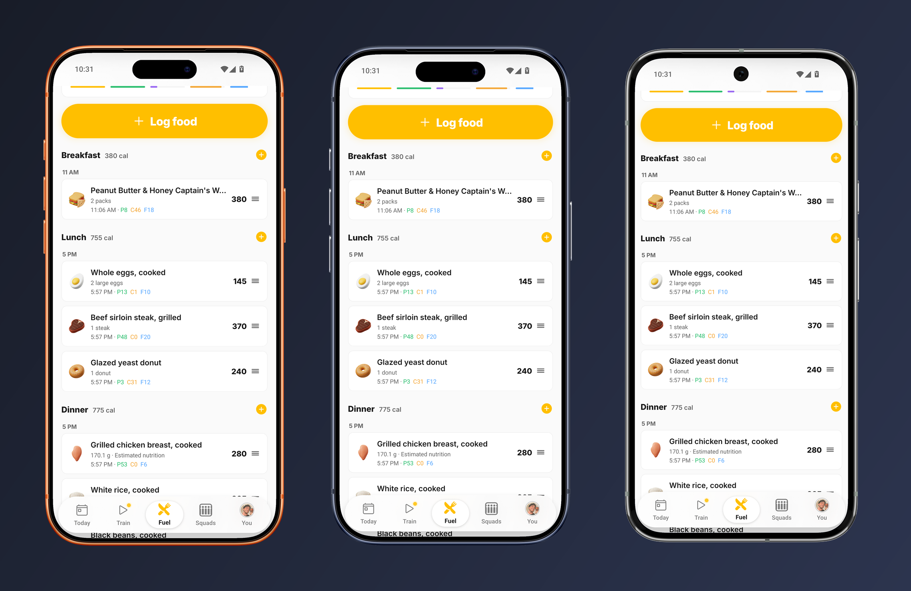
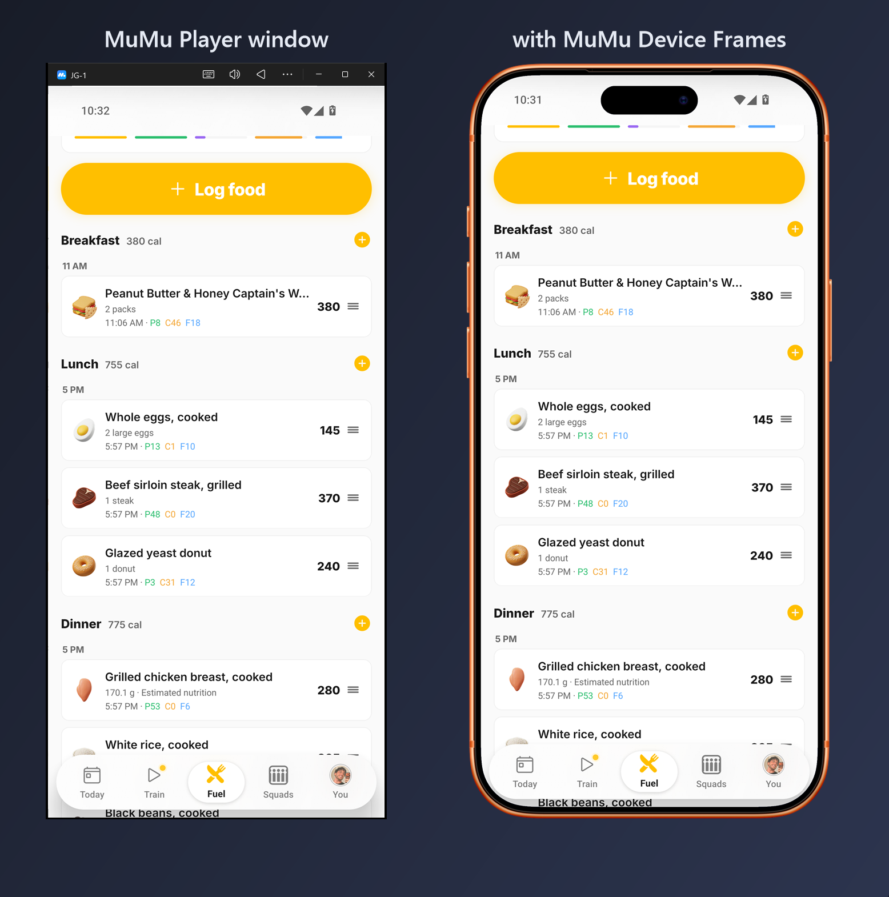
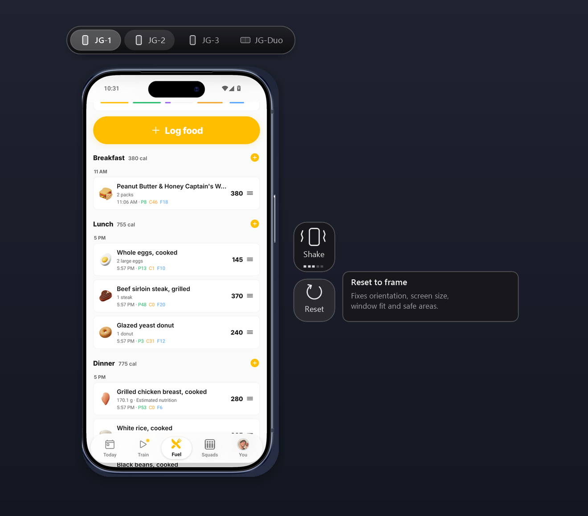
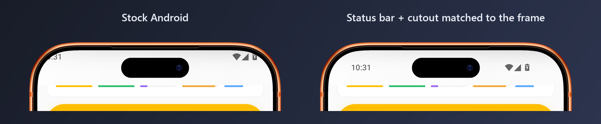
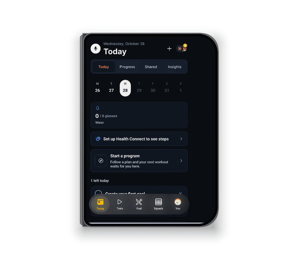
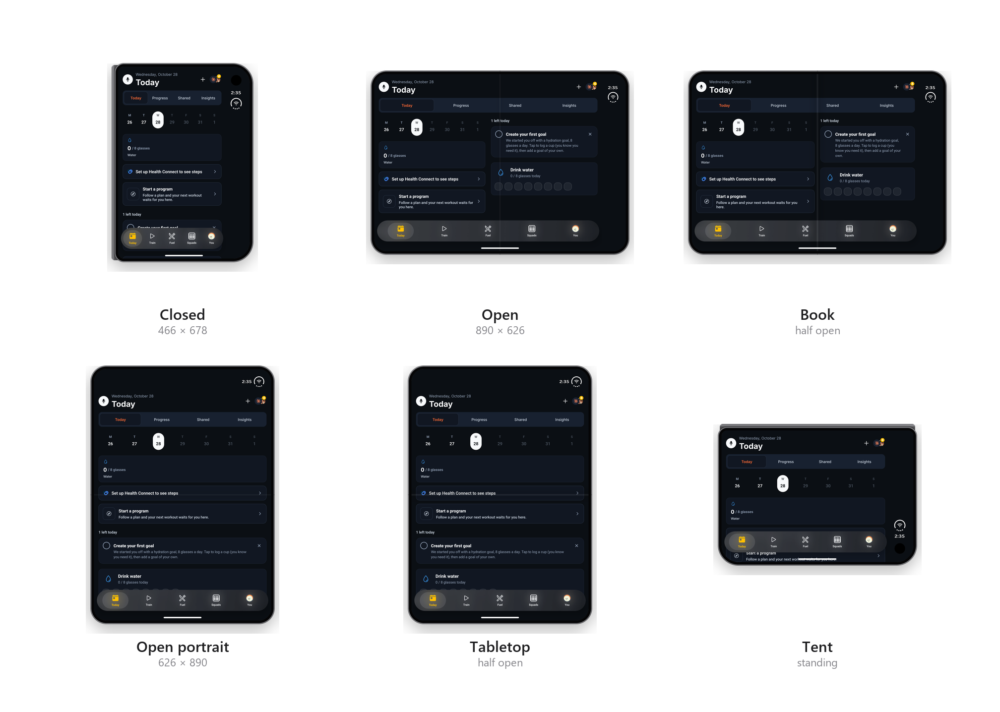
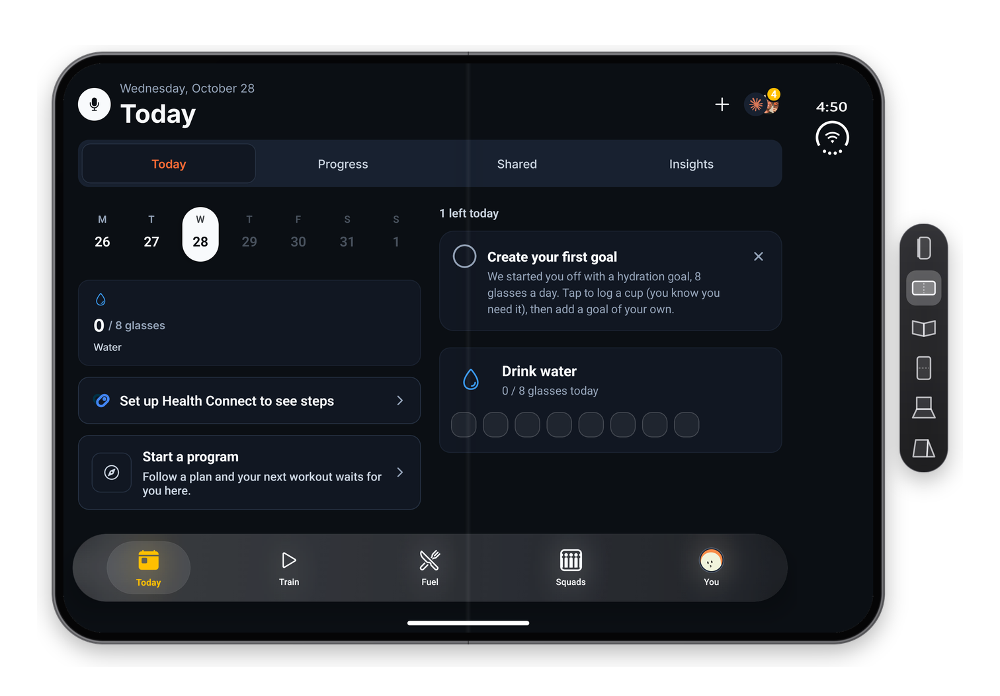
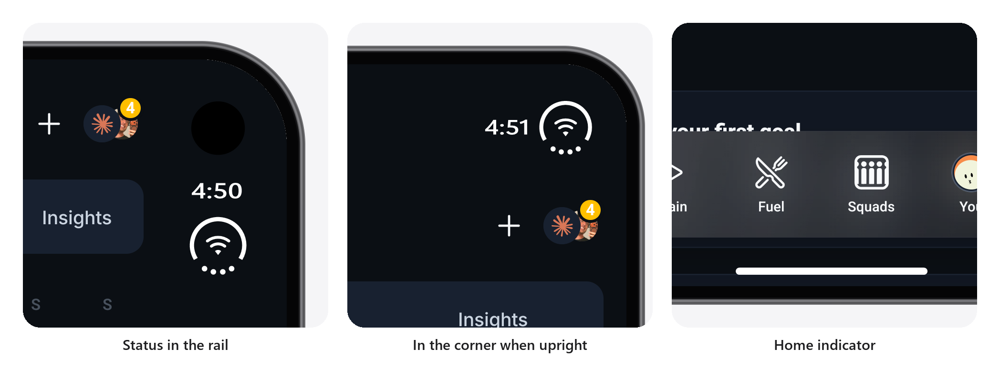
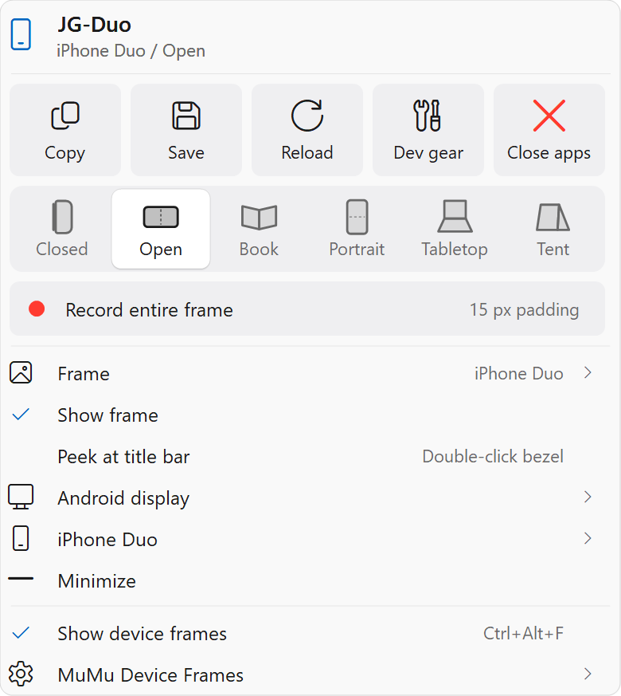

# MuMu Device Frames

Real phone frames around [MuMu Player](https://www.mumuplayer.com/) emulators, live on your desktop: for app demos,
screen recordings and screenshots.



## The emulator becomes the phone



MuMu's window disappears and the frame goes wherever the emulator goes. 145 iPhone, Pixel, Galaxy and iPad frames.
Open more than one emulator and they stack neatly in the same spot with a tab bar above the phone to swap between them.
If an emulator ever drifts sideways or out of scale, **Reset to frame** puts its orientation, resolution, safe areas
and window size back in one click.



## Android lays out like the phone



Apps get the phone's real island, corners and safe areas. On iPhone frames, iOS's status bar and home indicator
replace Android's.

## iPhone Duo

Apple's foldable, folding live. Six poses, one click each, and the app keeps running.









Android becomes a real foldable: apps see the fold, and the Duo's safe areas sit exactly where iOS puts them.
[How it works](docs/iphone-duo.md)

## Shake it, tilt it

Hold `Alt` and a shake button appears beside the phone. Tap it again quickly to shake harder, up to five levels. Hold
`Ctrl+Shift+Alt` and drag to tilt the whole device up to 18°, then let go and it eases back to flat. Android's
accelerometer feels all of it, so shake gestures and motion effects react on camera while the screen stays live.

## Screenshots and recordings

**Save** and **Copy** in the bezel menu capture the screen inside Android and place it in the frame at full resolution,
with transparent corners. Windows covering the emulator don't end up in the shot. Install
[ShareX with device frame recording](https://github.com/JustSuperHuman/ShareX/releases/latest) and **Record entire
frame** films the phone with a small margin and leaves the mouse pointer out. It also saves every click, so ShareX's
editor can add a tap ripple wherever a finger would have touched.

## Install

Needs Windows and [MuMu Player 12](https://www.mumuplayer.com/).

Download **MuMuDeviceFrames-Setup.exe** from [Releases](https://github.com/JustSuperHuman/MuMuDeviceFrames/releases)
and run it. No admin rights needed. Tick **Set up an iPhone Duo emulator** to get a Duo too. If you'd rather skip the
installer, unzip **MuMuDeviceFrames-win-x64.zip** from the same page into any folder and run it from there.

Or in PowerShell:

```powershell
irm https://raw.githubusercontent.com/JustSuperHuman/MuMuDeviceFrames/main/install.ps1 | iex
```

The app checks for updates daily. Use **Check for app updates…** in the tray menu to check now, then install and
restart when you're ready. Your frames and settings are kept. Automatic checks can be switched off in **Settings**.

## Use



| | |
| --- | --- |
| Drag the bezel | Move the phone |
| Tab bar above the phone | Swap between running emulators (right-click any tab for its menu) |
| Hold `Alt` | Show the shake, reset and iPhone Duo fold controls; release to hide them |
| Shake / Reset beside the phone | Shake the device (tap again for more strength), or reset orientation, size and safe areas to match the frame |
| `Ctrl+Shift+Alt` + drag the phone | Tilt with the mouse; release to return to neutral |
| Right-click the bezel | Screenshot, record, reset to frame, change frame, iPhone Duo pose |
| Double-click the bezel | Bring MuMu's title bar and toolbar back for a moment; again to hide them |
| `Ctrl+Alt+F` | All frames off or on |
| `Ctrl+Alt+R` / `Ctrl+Alt+G` | Reload the Expo app, or show and hide its dev gear |
| `Ctrl+Alt+1` to `Ctrl+Alt+6` | iPhone Duo poses (while an emulator is in front) |

Every option, hotkey and command is in the [reference](docs/reference.md).

---

Frames from [device-frames-media](https://github.com/jonnyjackson26/device-frames-media) by Jonny Jackson, downloaded
at first run. Built for [JustGains](https://justgains.com), the app in the screenshots. MIT, see [LICENSE](LICENSE).
