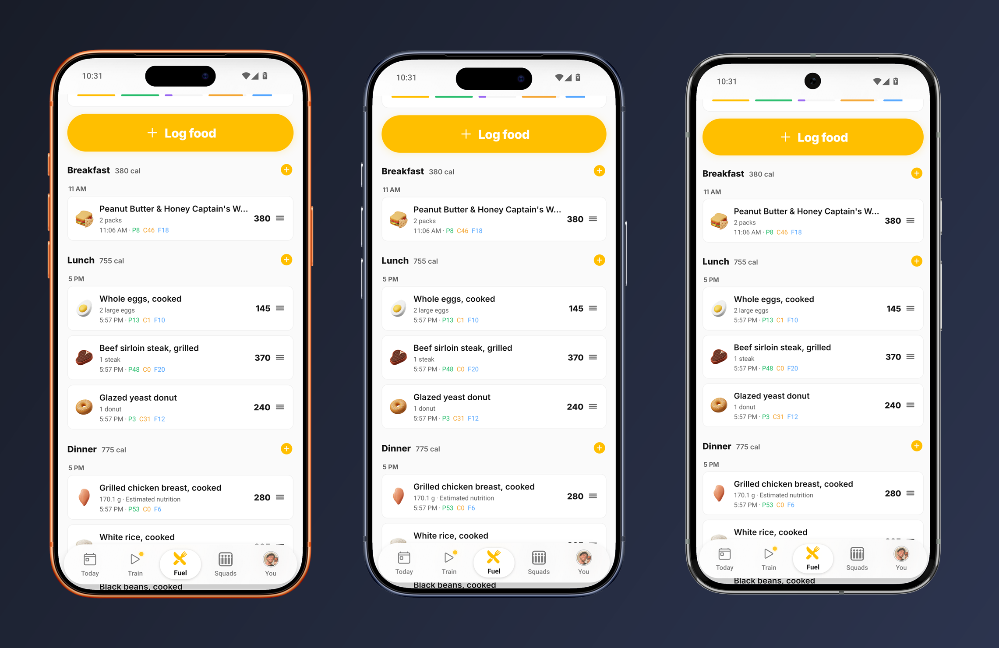
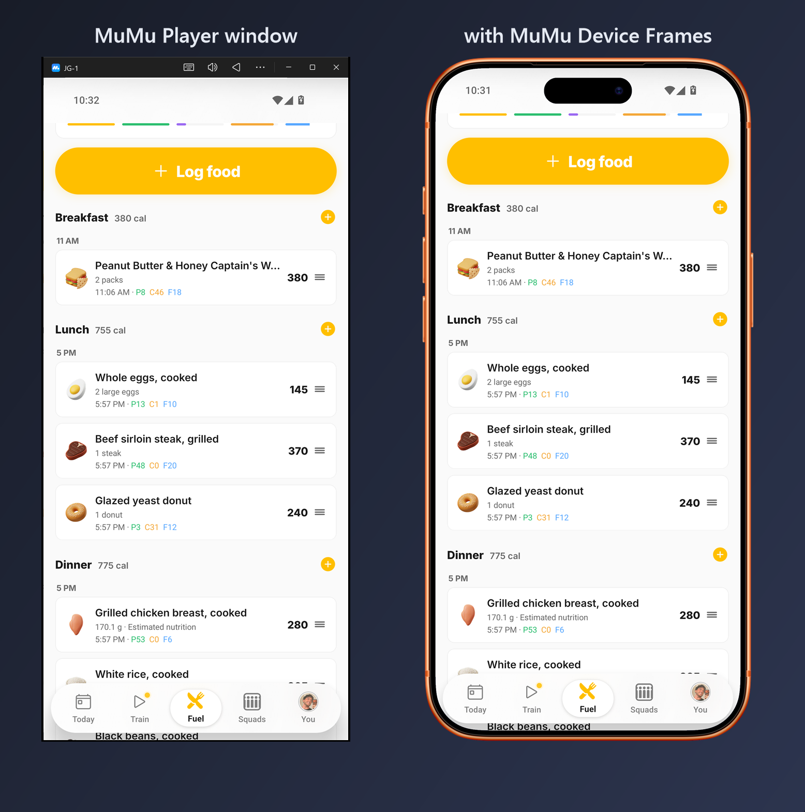
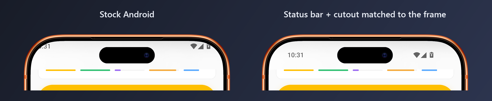
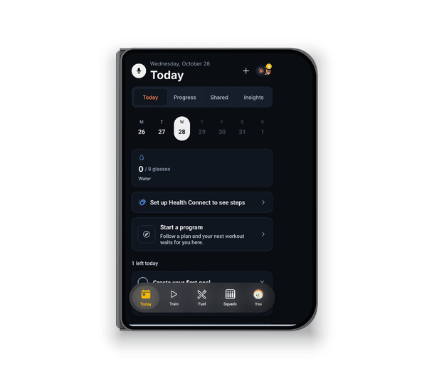
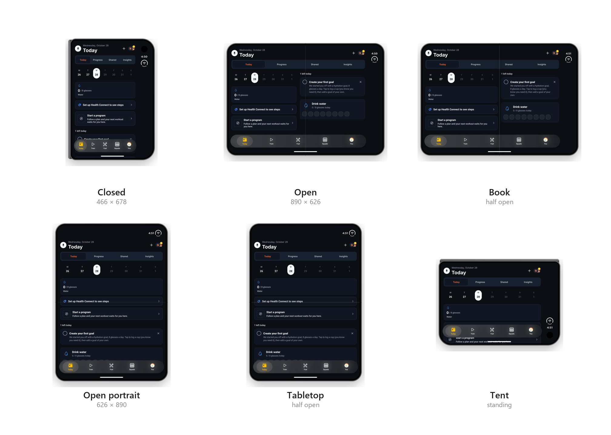
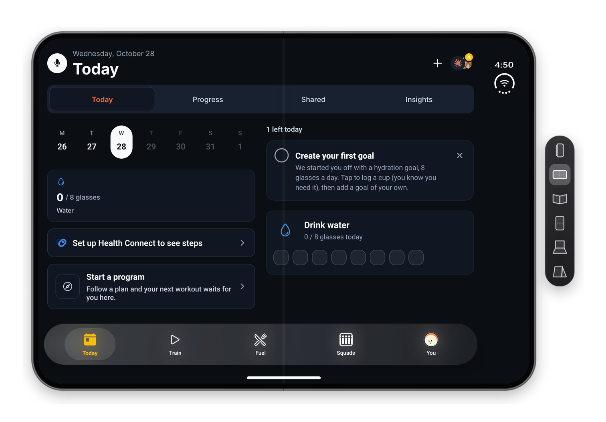
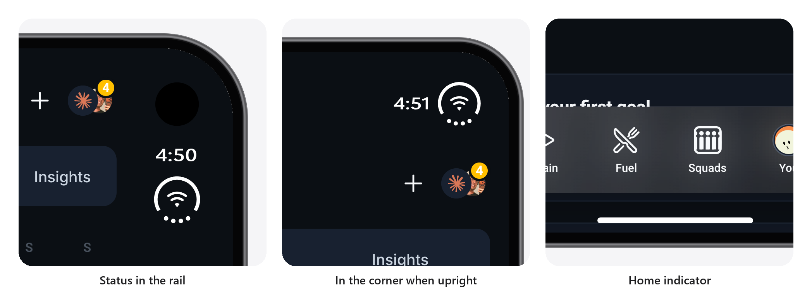
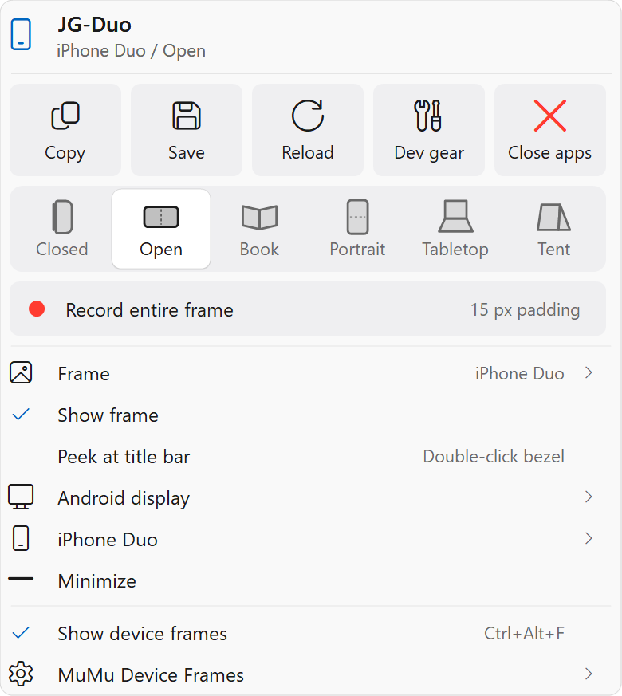

# MuMu Device Frames

Real phone frames around [MuMu Player](https://www.mumuplayer.com/) emulators, live on your desktop: for app demos,
screen recordings and screenshots.



## The emulator becomes the phone



MuMu's window disappears and the frame goes wherever the emulator goes. 145 iPhone, Pixel, Galaxy and iPad frames.

## Android lays out like the phone



Apps get the phone's real island, corners and safe areas. On iPhone frames, iOS's status bar and home indicator
replace Android's.

## iPhone Duo

Apple's foldable, folding live. Six poses, one click each, and the app keeps running.









Android becomes a real foldable: apps see the fold, and the Duo's safe areas sit exactly where iOS puts them.
[How it works](docs/iphone-duo.md)

## Install

Download **MuMuDeviceFrames-Setup.exe** from [Releases](https://github.com/JustSuperHuman/MuMuDeviceFrames/releases)
and run it. No admin rights needed. Tick **Set up an iPhone Duo emulator** to get a Duo too.

Or in PowerShell:

```powershell
irm https://raw.githubusercontent.com/JustSuperHuman/MuMuDeviceFrames/main/install.ps1 | iex
```

## Use



| | |
| --- | --- |
| Drag the bezel | Move the phone |
| Right-click the bezel | Screenshot, record, change frame, iPhone Duo pose |
| `Ctrl+Alt+F` | All frames off or on |
| `Ctrl+Alt+1` to `Ctrl+Alt+6` | iPhone Duo poses (while an emulator is in front) |

Every option, hotkey and command is in the [reference](docs/reference.md).

---

Frames from [device-frames-media](https://github.com/jonnyjackson26/device-frames-media) by Jonny Jackson, downloaded
at first run. Built for [JustGains](https://justgains.com), the app in the screenshots. MIT, see [LICENSE](LICENSE).
